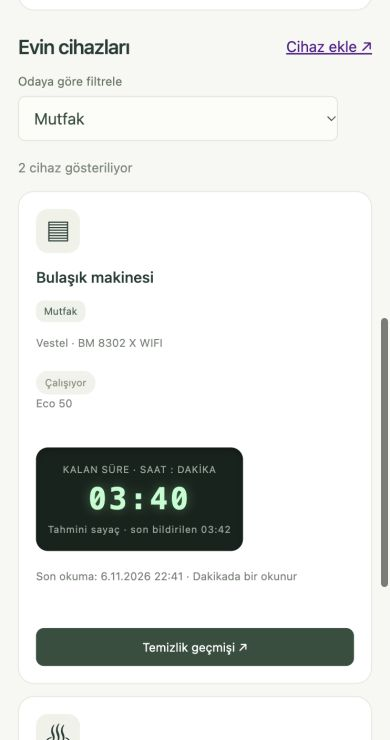
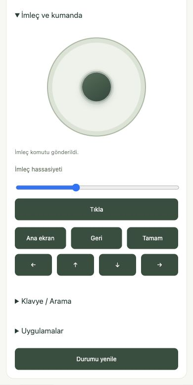
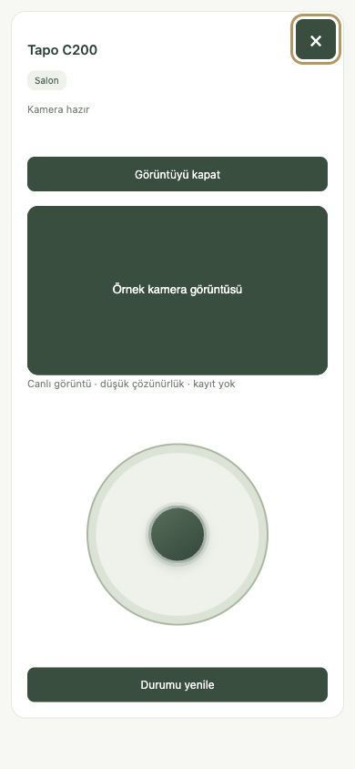

# Evimiz

**One dashboard for the smart devices in your home.**

[Read in Turkish](README.md) · [Quick start](#quick-start) · [Device support](#device-support) · [Architecture](docs/architecture.md) · [Contributing](docs/contributing.md)

Evimiz is an open-source, self-hosted smart home dashboard. Control devices from different brands and get reminders based on your preferences. Run it on a computer at home and add it to your iPhone Home Screen.

The project is in active development. Device support depends on the model and firmware. Use the manufacturer's app for initial pairing, account management, and firmware updates.

## Mobile view

The TV and camera screenshots use example device data. The dishwasher countdown is labeled as an estimate.

<p align="center">
  
  
  
</p>

## Features

- **Device control.** Adjust lighting and air conditioning, send the robot vacuum to selected rooms, or control an LG TV with a joystick, remote buttons, and keyboard.
- **Reminders and alerts.** Get notifications for supported device activity, periods of inactivity, connection quality, and nearby earthquakes. Choose which notifications you receive.
- **Automations.** Run supported actions based on time, temperature, or daylight. Vacation mode pauses automations and cleaning reminders.
- **Live monitoring.** View a Tapo camera, follow appliance countdowns, and see the robot vacuum's cleaning history and weekly chart.
- **Rooms and shared access.** Organize devices by room. Household members can sign in separately and receive Web Push notifications on iPhone.
- **Home information.** View temperature, weather, daylight, internet measurements, and visible network neighbors.

## Quick start

Install **Node.js 22.12+** and npm on a computer that can stay on. The [Samsung air conditioner adapter](docs/integrations/samsung.md) also needs Python.

```sh
npm ci
npm start
```

1. Open **http://127.0.0.1:4173** on the host computer.
2. Sign in locally as **`admin` / `admin`** and set a new password of at least eight characters.
3. Set up rooms, users, and devices in **Yönetim** (Administration). Connect each device with your own account or credentials.
4. Follow the [remote access](docs/remote-access.md) and [notification](docs/notifications.md) guides for HTTPS and iPhone notifications. These setup guides are in Turkish.

To access the dashboard from another device on your home network, start it with `HOST=0.0.0.0 npm start` and use the host's LAN address. Web Push on iPhone requires trusted HTTPS and user permission. For optional Tailscale Funnel access, point Funnel at the authenticated gateway in `public-proxy.mjs`.

## Device support

| Integration and model | Capabilities and requirements |
|---|---|
| **Tuya / Smart Life** — ACK Smart LED 10 W | Power, brightness, warm and cool white. Requires the local key, device ID, IP, and compatible data points. [Guide](docs/integrations/tuya.md) |
| **Samsung WindFree** — AR70F18C1DB/SK | Power, mode, setpoint, and measured temperature. Local Python adapter with model and firmware constraints. [Guide](docs/integrations/samsung.md) |
| **Vestel / Akıllı Yaşam** — KCMI 98142 WIFI, BM8302 X WIFI | Read-only cloud access for program, remaining time, and activity. Requires your account and an authorized service client. [Guide](docs/integrations/vestel.md) |
| **Xiaomi robot vacuum** — `dreame.vacuum.p2140p` | Start, pause, dock, battery, cleaning counter, and room selection. Requires the device ID, token, and its own map. A room command started cleaning on the tested device. Completion by individual room has yet to be verified. [Guide](docs/integrations/xiaomi.md) |
| **Xiaomi air fryer** — `careli.fryer.maf02`, 3.5 L | Read-only status, setpoint, and remaining time. A sleeping appliance may stop responding. [Guide](docs/integrations/xiaomi.md) |
| **Tapo C200** | Admin-only video and analog pan/tilt with FFmpeg and a camera account. Live video and physical movement were verified on a real C200. [Guide](docs/integrations/tapo.md) |
| **LG webOS** — 65QNED86T6A | Power, sound, media controls, pointer, keyboard, and apps. Pairing requires TV approval. Some actions vary by app and firmware. Wake-on-LAN requires the TV's MAC address. [Guide](docs/integrations/lg.md) |

## Architecture and private data

A Node.js server serves the HTML, CSS, and JavaScript PWA. Device adapters share a per-device cache. LG subscriptions and Server-Sent Events keep open screens up to date. Web Push handles background notifications. Device responses and physical outcomes are tracked separately. Estimated Vestel completion is labeled in the UI.

The server enforces sessions, roles, and CSRF protection. Credentials, session records, network addresses, maps, and history stay in the Git-ignored `data/` directory. Each installation connects its own devices. See [Architecture](docs/architecture.md), [Data refresh](docs/data-updates.md), and [Security](docs/security.md).

## Development

```sh
npm ci
npm run check
npm run check:public
```

Unit tests use synthetic fixtures. HTTP tests run against a temporary clean installation. [Contribution guide](docs/contributing.md) · [Device adapter contract](docs/device-integration.md)

## Roadmap

- Simplify Xiaomi map retrieval and setup.
- Support more device models and native status updates.
- Add household budgets, receipt upload and processing, and spending charts.
- Let household members ask about device status and confirm commands through chat.

## License

[MIT](LICENSE). Third-party components and manufacturer services have their own terms. [Third-party components](docs/third-party.md)
