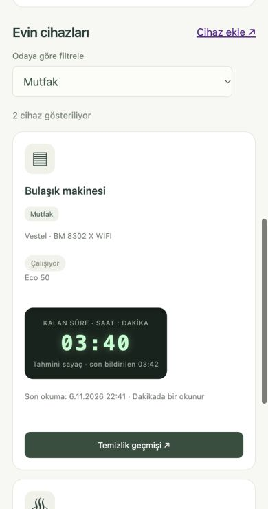
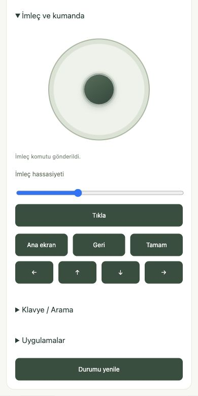
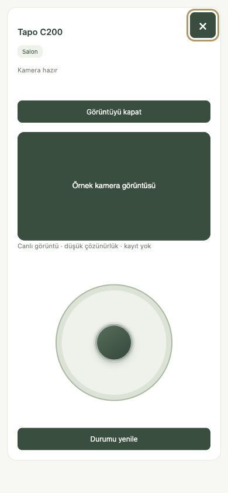
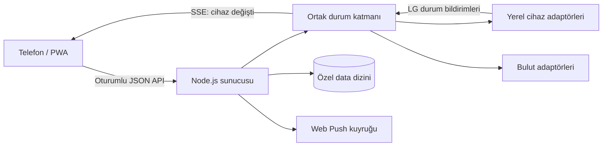

<div align="center">

# Evimiz

**Farklı markalar, tek ev paneli.**

Kendi sunucunuzda çalışan akıllı ev paneli · Node.js · PWA · Yerel cihaz adaptörleri · Canlı güncellemeler


[English](README.en.md) · [Kurulum](#hızlı-kurulum) · [Cihazlar](#cihaz-desteği) · [Mimari](docs/architecture.md) · [Belgeler](docs/README.md) · [Katkı](docs/contributing.md)

</div>

Evimiz, evdeki akıllı cihazları tek panelden kontrol etmenizi ve tercihlerinize göre evle ilgili hatırlatmalar almanızı sağlar. Açık kaynaklı paneli kendi bilgisayarınızda çalıştırabilir ve iPhone'unuzun ana ekranına ekleyebilirsiniz.

**Geliştirme aşamasındadır.** Desteklenen cihazlar ve doğrulanan işlevler aşağıdaki tabloda yer alır. İlk eşleştirme, hesap yönetimi ve firmware güncellemeleri için üretici uygulamaları kullanılır.

## Mobil görünüm

Güncel arayüzden alınmış mobil tarayıcı görüntüleri. TV ve kamera kontrolleri örnek cihaz verileriyle gösterilir. Kalan süre tahmini olarak etiketlenir; ekran görüntüleri anlık cihaz durumunun kaydıdır.

<p align="center">
  
  
  
</p>

## Neler yapar?

- **Tek panelden cihaz kontrolü.** Ampulün rengini ve parlaklığını ayarlayın, klimayı yönetin, robotu seçtiğiniz odalara gönderin veya TV'yi analog kumanda ve klavyeyle kullanın.
- **Tercihlerinize göre hatırlatmalar.** Desteklenen cihazlar çalışmaya başladığında veya işi bittiğinde bildirim alın. Uzun süre kullanılmayan cihazlar, internet bağlantısı ve yakın deprem uyarıları için bildirimleri seçin.
- **Otomasyonlar.** Saat, sıcaklık veya gün ışığına göre desteklenen cihazları çalıştırın. Tatil modunda otomasyonları ve temizlik hatırlatmalarını askıya alın.
- **Canlı takip.** Tapo kamerayı açın, çamaşır, bulaşık ve airfryer için kalan süreyi izleyin. Robotun temizlik geçmişini ve haftalık grafiğini görün.
- **Odalar ve ortak kullanım.** Cihazları odaya göre düzenleyin. Ev üyeleri kendi hesaplarından aynı paneli kullanabilir ve iPhone'da Web Push bildirimleri alabilir.
- **Ev bilgileri.** İç ve dış sıcaklığı, hava durumunu, gün doğumu ve batımını, internet ölçümlerini ve görülebilen yerel ağ cihazlarını takip edin.

## Hızlı kurulum

**Gerekenler:** Node.js **22.12+**, npm ve açık kalacak bir bilgisayar. Samsung yerel klima adaptörü için ayrıca Python ortamı gerekir; [Samsung rehberini](docs/integrations/samsung.md) izleyin.

```sh
# Proje klasöründe çalıştırın
npm ci
npm start
```

1. Sunucunun kendi bilgisayarında **http://127.0.0.1:4173** açın.
2. Başlangıç hesabı **`admin` / `admin`** ile giriş yapın. Bu ilk giriş yalnız loopback üzerinden kabul edilir.
3. En az **8 karakterli** yeni parola belirleyin; değiştirmeden cihaz/API kullanımı açılmaz.
4. Yönetimden evinizi, odaları, kullanıcıları ve cihaz kayıtlarını oluşturun.
5. Her cihaz için **kendi bağlantınızı** kurun. Cihaz kaydı oluşturmak bağlantının tamamlandığı anlamına gelmez.
6. HTTPS/iPhone bildirimleri için [dış erişim](docs/remote-access.md) ve [bildirim](docs/notifications.md) rehberlerini izleyin.

Ev ağındaki telefonların erişimi için:

```sh
HOST=0.0.0.0 npm start
```

Telefonda sunucunun yerel adresini kullanın. Ana ekrandan Web Push için güvenilir HTTPS ve iPhone'da kullanıcı izni gerekir. Tailscale Funnel mevcut bilgisayarda çalışabilir; her kurulum kendi hesabını ve adresini oluşturur. Dış yayında hedef, giriş korumalı `public-proxy.mjs` geçididir; kurulum uçları dış erişime kapatılır.


## Cihaz desteği

Aşağıdaki kapsam model/protokol düzeyindedir. Aynı markanın farklı ürünü yeni eşleme veya adaptör gerektirebilir.

| Entegrasyon / mevcut model | Kontrol ve okuma | Kurulum / sınır |
|---|---|---|
| **Tuya / Smart Life** — ACK Smart LED 10 W | Aç/kapat, parlaklık, sarı/beyaz | Yerel anahtar, cihaz kimliği, IP ve uyumlu DP eşlemesi. [Rehber](docs/integrations/tuya.md) |
| **Cata / Tuya akıllı priz** | Deneysel yerel aç/kapat | Her priz için ayrı kimlik, anahtar, IP ve doğrulanmış aç/kapat DP numarası gerekir. Fiziksel test bekliyor. |
| **Samsung** — AR70F18C1DB/SK WindFree | Güç, mod, hedef ve ölçülen sıcaklık | Modele/firmware'e bağlı yerel Python adaptörü. SmartThings'in tüm cihazları değildir. [Rehber](docs/integrations/samsung.md) |
| **Vestel / Akıllı Yaşam** — KCMI 98142 WIFI, BM8302 X WIFI | Program, kalan süre ve aktivite takibi | **Salt okunur bulut bağlantısı.** Kendi hesabınız ve yetkili servis istemcisi bilgileri gerekir; herkese açık hazır OAuth sihirbazı yoktur. [Rehber](docs/integrations/vestel.md) |
| **Xiaomi robot** — `dreame.vacuum.p2140p` | Başlat/duraklat/şarja dön, pil, sayaç, oda seçimi | Kendi DID/token ve robota ait harita gerekir. Mevcut cihazda oda komutunun temizliği başlattığı gözlendi; tek tek odaların tamamlanması doğrulanmaz. Yeni harita edinimi tam otomatik değildir. [Rehber](docs/integrations/xiaomi.md) |
| **Xiaomi airfryer** — `careli.fryer.maf02`, 3.5 L | Durum, hedef sıcaklık ve kalan süre | **Salt okunur.** Uyku/kapalı durumunda yerel sorgu yanıtı alınamayabilir. [Rehber](docs/integrations/xiaomi.md) |
| **Tapo C200** | İsteğe bağlı, sunucudan paylaşılan düşük çözünürlüklü görüntü | Kamera hesabı ve FFmpeg gerekir. ONVIF üzerinden analog yön kontrolü sunar. Ses ve kayıt yok; yalnız yönetici. Canlı akış ve analog yön kontrolü gerçek C200 üzerinde doğrulandı. [Rehber](docs/integrations/tapo.md) |
| **LG webOS** — 65QNED86T6A | Güç/ses, oynat/duraklat, imleç, yön tuşları, metin/Enter/silme, uygulama listesi | TV ekranında eşleştirme onayı. Özellikler uygulama/firmware'e bağlı; ağdan açma için MAC ve WOL gerekir. Metin gönderimi/medya eylemleri her uygulamada fiziksel olarak doğrulanmadı. [Rehber](docs/integrations/lg.md) |

Xiaomi ve Tuya gibi yerel bağlantılar internetten bağımsız okunabilir; Vestel, hava verileri, dış erişim ve Web Push ilgili internet servislerine bağlıdır.

## Nasıl çalışır?



**Bir cihaz, ortak okuma.** Telefonlar ve arka plan işleri cihaz örneği kimliğine bağlı aynı önbelleği ve aynı devam eden sorguyu kullanır. Normal cihaz okumaları yaklaşık 30 saniyede paylaşılır; Vestel'in bulut sorgusu 60 saniyededir. Sayaç ekranının saniyelik ilerlemesi cihazı saniyede bir sorgulamaz.

**Push ve periyodik sorgulama.** LG'nin güç/ses abonelikleri açık ekranları günceller. `/api/device-events` tek oturumlu SSE bağlantısıyla yalnız cihaz kimliğini bildirir; tarayıcı yetkili API'den ortak durumu okur. Canlı bağlantı koparsa 30 saniyelik yedek sorgu devreye girer. Diğer markalarda şimdilik periyodik okuma kullanılır; her dış uygulama değişikliğinin anlık ulaşması beklenmez.

**Komut, kabul ve sonuç ayrıdır.** Cihazın komutu kabul etmesi fiziksel sonucun kanıtı sayılmaz. Komutlar otomatik tekrarlanmaz. Durum okuması başarısızsa bilinmeyen değer “kapalı/tamamlandı” yapılmaz. Vestel sayacı sıfıra indiğinde oluşturulan bitiş özellikle **“tahmini tamamlandı”** diye işaretlenir; gerçek bitiş daha sonra aynı kaydı onaylar ve ikinci bildirim üretmez.

**Çalışmalar olaylardan türetilir.** Ham başlangıç/bitiş olayları korunur, arayüzde tek çalışma halinde gruplanır. Robot oda adları kabul edilen panel/otomasyon seçiminin kopyasıdır; eski veya Xiaomi Home'dan başlatılan çalışmalara oda bilgisi uydurulmaz. Haftalık grafik ev saat diliminde çalışmayı bir kez sayar.

**IP değişimi.** Xiaomi ve Tuya cihaz kimliği/anahtar doğrulamasıyla, LG/Samsung kayıtlı veya öğrenilmiş MAC ve başarılı okumayla adres kurtarmayı dener. İlk kimlik kaydı ve ağ izolasyonu sınırları vardır. [DHCP rezervasyonu ve yerel ağ rehberi](docs/local-network.md)

**Dış çevre verileri:** Hava 10 dakikada, MGM 15 dakikada, güneş saatleri evin her yerel günü için sunucuda zamanlanır; AFAD iki dakikada kontrol edilir. Pasif çevre API okumaları ağ çağrısı yapmaz. Son başarılı sonuç ve hata bilgisi özel diskte korunur; aynı kaynağın devam eden işi paylaşılır. Kullanıcının konum araması, hesap bağlaması, komutu veya görüntüyü açması gibi bilinçli eylemler yine sunucudan ilgili kaynağa gider.

Ayrıntılar: [Mimari](docs/architecture.md) · [Veri güncelleme aralıkları](docs/data-updates.md) · [Adaptör sözleşmesi](docs/device-integration.md)

## Güvenlik ve özel veriler

- Yönetici/üye yetkileri API'de uygulanır; yazmalarda oturum ve CSRF kontrolü vardır.
- Parolalar `scrypt` ile hash'lenir. Oturum çerezi HttpOnly/SameSite'tır. “Beni hatırla” 30 günlük oturum özeti saklar; normal oturum bellektedir.
- Anahtarlar, hesap oturumları, IP/MAC, ev haritası, kullanıcılar ve gerçek geçmiş yalnız **`data/`** altında kalır. Bu klasör Git dışındadır; örnek dosyalara kopyalanmaz.
- Temiz kurulum sizin Tuya, Xiaomi, Vestel, Samsung veya LG hesabınızı/anahtarınızı içermez. Yeni kullanıcı kendi cihazlarını kendisi bağlar.
- Özel kurulum uçları yerel yöneticiyle sınırlıdır. İnternete açılan geçit bu uçları engeller; uygulamanın giriş korumasını kaldırmaz.
- Yerel adresler ve komut alanları izin listeleriyle doğrulanır. Yapılandırmadan keyfî kod çalıştırılmaz.

[Güvenlik kapsamı ve bildirim yolu](docs/security.md). Proje bağımsız güvenlik denetiminden geçmiş değildir.

## Geliştirme ve doğrulama

```sh
npm ci
npm run check         # Birim + izole HTTP + belge bağlantıları
npm run check:public  # Git'in izlediği dosyalarda özel veri kontrolü
```

Mevcut test setinde **87 birim testi** ve **2 HTTP testi** vardır. Ortak sorgu birleştirme, eski okumanın yeni bildirimi ezmemesi, sayaç uzlaşması, rol/CSRF, oturum iptali, çoklu cihaz, gizli veri kapsamı ve Funnel akış temizliği test edilir. HTTP testleri geçici boş kurulum kullanır; evin `data/` klasörünü fixture yapmaz. Test sayısı bir kalite garantisi veya fiziksel model uyumluluğu kanıtı değildir.

### Repo düzeni

```text
server.mjs, *-*.mjs     Sunucu ve işlevlerine ayrılmış ESM modülleri
static/                 Sayfalar, mobil arayüz, PWA ve canlı istemci
samsung-local.py         Samsung yerel protokol köprüsü
xiaomi-setup.py          Xiaomi hesap/cihaz kurulum köprüsü
tests/                  Birim ve izole HTTP testleri
docs/                   Kurulum, mimari ve entegrasyon rehberleri
  media/                İncelenmiş mobil ekran görüntüleri
examples/               Yalnız sahte yapılandırma örnekleri
scripts/                Doküman ve özel veri kontrolleri
.github/                CI ve hata/cihaz desteği şablonları
data/                   Özel çalışma verileri — Git dışında
```

Sunucu modülleri işlev adlarıyla kökte tutulur; ek derleme veya framework zorunluluğu yoktur. Yeni adaptör ekleme, marka adını seçmekten farklı bir geliştirme işidir. AI kullanılabilir; zorunlu değildir. [Katkı rehberi](docs/contributing.md) ve [AI/geliştirici sözleşmesi](docs/device-integration.md) aynı kimlik, güvenlik ve doğrulama kurallarını kullanır.

## Yol haritası

- Xiaomi harita edinimini ve yeni kurulum adımlarını kolaylaştırmak.
- Daha fazla cihaz adaptörü ve cihazın sunduğu durum bildirimlerini kullanmak.
- Hane bütçesi, alışveriş fişi yükleme ve işleme, gider grafikleri.
- Sohbet üzerinden cihaz durumu sorma ve onaylı cihaz komutları.

## Lisans

[MIT](LICENSE). [Üçüncü taraf paketlerin lisansları](docs/third-party.md) ve üretici servislerinin hakları/koşulları kendilerine aittir. Bu proje üreticilerle bağlantılı resmî bir uygulama değildir; entegrasyonlar üretici onayı iddiası taşımaz.
